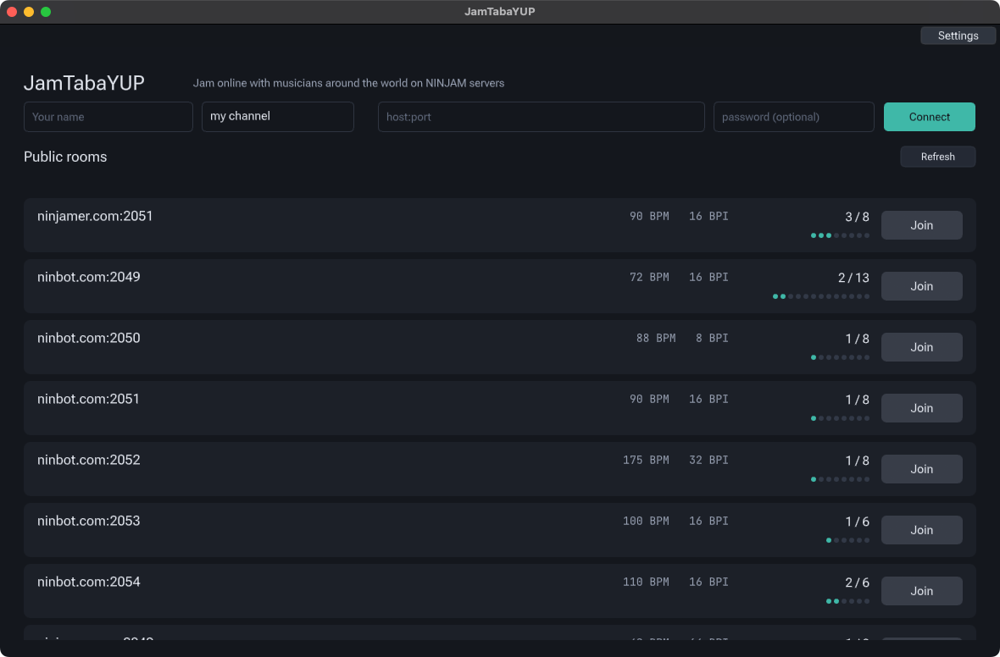
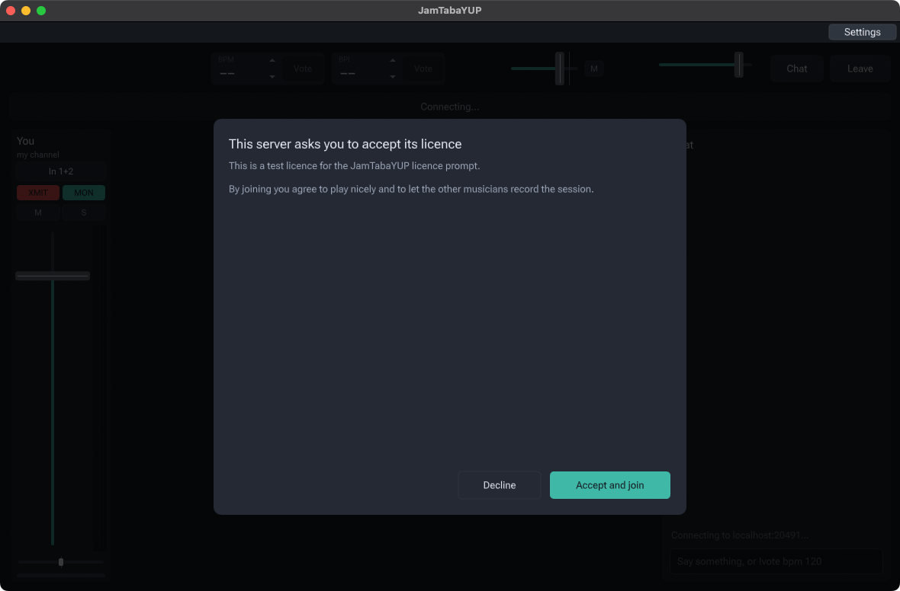

# Your first jam

## 1. Name yourself

When JamTabaYUP is not in a room, it shows the server browser. Type your name
in the first field; the others see it next to your channel. Spaces, `@` and `:`
are removed, because NINJAM servers don't allow them. The second field names
your channel, for example "guitar" or "vocals".

## 2. Pick a room

**Public rooms** lists the NINJAM servers that ninbot.com watches, refreshed
every 30 seconds, busiest first. Each card shows:

- the server address,
- its current tempo (BPM) and interval length (BPI),
- how many people are in it, one dot per seat, and their names.

Click a card, or its **Join** button, to go in.

A room with nobody but its bot is a good place to try things out alone. A busy
room is a good place to listen first: turn your XMIT off (see
[your channel](your-channel.md)) until you're ready to play along.

## 3. Or connect to a private server

Type the address as `host:port` (for example `ninbot.com:2049`, or a friend's
server), add a password if the server needs one, and click **Connect** or press
Enter. Without a password, JamTabaYUP logs in anonymously, which most public
servers allow.

## 4. Accept the server's licence

Many servers show a licence agreement first: the terms of playing there,
usually that sessions may be recorded or streamed. Read it, then click
**Accept and join** or **Decline**.

## 5. Play

You're in [the jam room](jam-room.md). Listen for a few intervals to get the
form of the tune, then play along. What you play reaches the others one
interval later, lined up with their beat.

To leave, click **Leave**. If the connection drops, you're back in the browser
with the reason shown above the room list.
