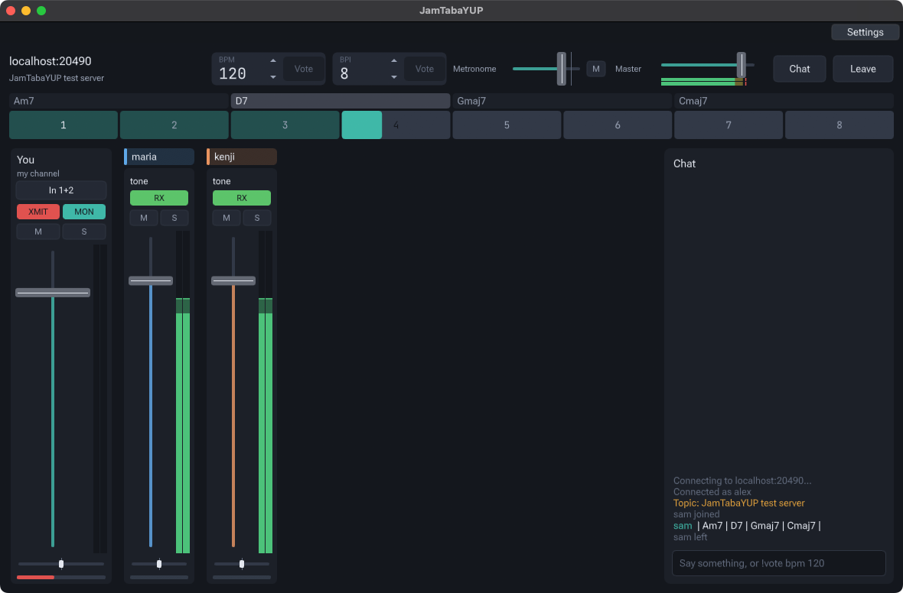

# JamTabaYUP

JamTabaYUP lets you play music live with musicians anywhere in the world over
[NINJAM](https://www.cockos.com/ninjam/) servers. It runs as a standalone app,
or as an AU, VST3 or CLAP plugin inside your DAW, on macOS (Apple Silicon and
Intel) and Windows.

## How NINJAM jamming works

Over the internet, sound always arrives late, too late for playing in time
together the usual way. NINJAM turns the delay into part of the music:

- The server sets a tempo (**BPM**) and a loop length in beats (**BPI**,
  beats per interval). Together they make an **interval**, for example 16
  beats at 120 BPM, 8 seconds.
- While you play an interval, JamTabaYUP records it and streams it to the
  others. You hear what everyone else played **in the interval before**, lined
  up with your beat.
- So everyone plays along with everyone else, one interval behind. It suits
  music built from repeating forms: blues choruses, grooves, chord loops, jams.

You hear yourself live, through your interface, your DAW or JamTabaYUP's own
monitoring. A metronome keeps everyone on the same grid.

## Where to start

1. [Install JamTabaYUP](installing.md).
2. [Join your first jam](first-jam.md).
3. Learn [the jam room](jam-room.md).

JamTabaYUP is a new, open-source implementation inspired by
[JamTaba 2](https://github.com/elieserdejesus/JamTaba). See
[what's different](differences.md).
