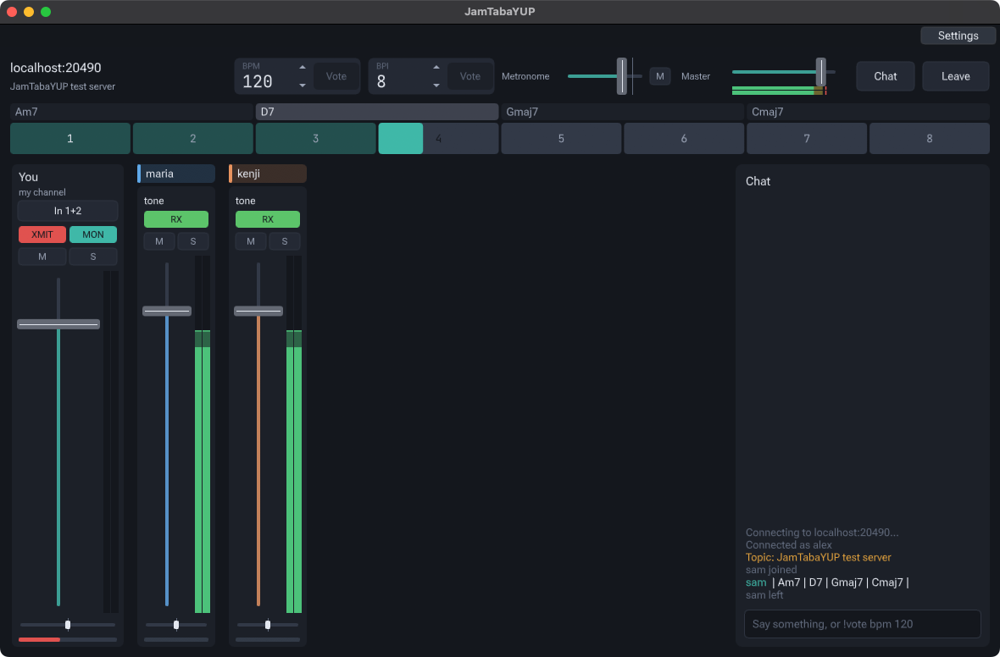

# The jam room

From top to bottom:

## Top bar

- **Server and topic**: the address you're on, how many people are in it, and
  the server's topic.
- **BPM** and **BPI**: the server's tempo and interval length, with arrows and
  a **Vote** button for proposing a change. See
  [tempo and voting](tempo.md).
- **Metronome**: its volume, and **M** to mute it.
- **Master**: the volume of everything JamTabaYUP plays, with a level meter.
- **Chat**: shows or hides the chat panel.
- **Leave**: disconnects and goes back to the server browser.

## Beat bar

One block per beat of the interval. Beats already played are dim, and the
beat in progress fills as it goes. Beat 1 is where each interval starts: what
the others played in the last interval begins again here.

When someone posts a chord progression in chat, its measures appear above the
beats. See [chat and chord progressions](chat.md).

## Your channel

On the left: what you send, and how you hear yourself. See
[your channel](your-channel.md).

## Other musicians

In the middle, one coloured group per musician, with a strip for each channel
they send. Scroll sideways with the mouse wheel or trackpad when there are more
than fit. See [other musicians](other-musicians.md).

## Chat

On the right: messages, the topic, people joining and leaving, and tempo
changes. Type in the box at the bottom and press Enter.

The window can be resized; the strips and chat make room.
